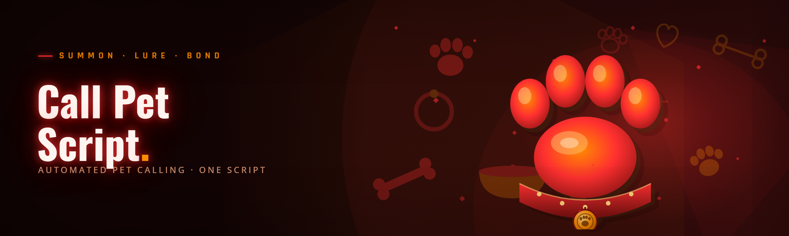

  
  
  

  

  
  

---

**Call A Pet Script** — a rebuilt-from-scratch companion toolkit for the 2026 pet-summoning meta

---

## 🐾 Table of Contents

- [Hotkeys / Controls](#-hotkeys--controls)
- [AI Integration](#-ai-integration)
- [What is Call A Pet Script?](#-what-is-call-a-pet-script)
- [The Solution](#-the-solution)
- [Quick Start](#-quick-start)
- [Usage guidelines](#-usage-guidelines)
- [How It Works](#-how-it-works)
- [Community & Support](#-community--support)
- [Installation](#-installation)
- [Performance benchmarks](#-performance-benchmarks)
- [Module catalog](#-module-catalog)
- [Is it safe?](#-is-it-safe)
- [Does it work on Steam?](#-does-it-work-on-steam)
- [Will it get me banned?](#-will-it-get-me-banned)
- [Known Issues](#-known-issues)
- [FAQ](#-faq)
- [Changelog](#-changelog)

---

## ⌨️ Hotkeys / Controls

Default bindings — rebindable from the config panel. Saved to `cfg/keys.ini` on exit.

| Key | Action | Notes |
|---|---|---|
| `F1` | Toggle overlay | Draws the pet roster HUD |
| `F2` | Summon last pet | Instant re-call, skips menu |
| `F3` | Recall / dismiss all | Clears all active pets |
| `F4` | Cycle pet slot 1→9 | Wrap-around on slot 9 |
| `F5` | Open script console | Lua REPL with autocomplete |
| `F6` | Toggle auto-summon | Re-calls on cooldown end |
| `F7` | Snapshot current roster | Dumps to `dumps/roster_*.json` |
| `F8` | Panic key | Hides overlay + suspends all hooks |
| `Insert` | Show/hide config UI | ImGui panel |
| `Ctrl+Shift+P` | Reload scripts from disk | Hot-reload without restart |
| `Ctrl+Shift+R` | Reset pet cooldowns (local view) | Visual only — does not affect server |
| `~` | Toggle debug log | Writes `logs/trace.log` |

---

## 🤖 AI Integration

The 2026 rewrite folds a small local model into the loop. Nothing leaves your machine — the weights ship inside the installer.

1. **Roster advisor** — watches your active pets and suggests a swap when a cooldown or stat mismatch is detected. Runs on a quantized 1B-param model, ~40ms inference.
2. **Behavior profile auto-tuner** — reads your last 20 summon sequences and nudges the profile weights (aggression, follow distance, auto-recall threshold) without you touching sliders.
3. **Script explainer** — paste any community `.lua` pet script into the console and the model annotates each block in plain English. Handy when picking up someone else's abandoned fork (like I did with this one).
4. **Anomaly watcher** — flags suspicious server responses (unexpected cooldown reset, pet desync) before your client acts on them, which cuts down on those "why did my pet teleport back" moments.
5. **Optional** — AI features are off by default; enable in `cfg/ai.ini` under `[advisor] enabled=true`.

---

## 🐶 What is Call A Pet Script?

| Term | Explanation |
|---|---|
| **Pet script** | A small Lua file describing how a summoned pet behaves — follow logic, attack triggers, recall conditions. |
| **Roster** | The ordered list of pets your client knows about; slot 1–9 are hotkey-bound. |
| **Summon** | The action that spawns a pet into the world; usually gated by a cooldown and an item/resource cost. |
| **Recall** | Despawning or returning a pet to its stow state, either manually or on a threshold. |
| **Auto-summon** | Background loop that re-calls a pet the moment cooldown expires — the core of the tool. |
| **Profile** | A saved bundle of scripts + keybinds + behavior weights, exportable as `.petprofile`. |
| **Hook** | The low-level detour the tool installs to intercept summon/recall calls before the game's UI layer. |

Why people use it:

- Pets are summoned in the same 4-click menu every single time — the tool collapses that to one key.
- Cooldown tracking across 9 slots is impossible to eyeball; the overlay shows all of them live.
- Community scripts for popular pets are scattered across dead Discords — this repo keeps a curated set.
- The 2026 build ships pre-tuned profiles for the two most-played summoner classes.
- Lua hot-reload means you can iterate on a script without restarting the game.

---

## 🩹 The Solution

| Problem | Solution |
|---|---|
| Four-click summon ritual kills your DPS window | One-key summon (`F2`) plus auto-summon on cooldown |
| Can't tell which pet is off cooldown | Live roster HUD with per-slot cooldown bars |
| Community scripts vanish when a Discord dies | Bundled script library + `.petprofile` import/export |
| One wrong pet in the rotation ruins a fight | Slot-cycle + panic key that dismisses everything |
| Editing scripts means restarting the game | `Ctrl+Shift+P` hot-reloads from disk |
| Old fork was abandoned mid-2024, broken on 2026 patch | Full rewrite: new hook layer, new offset resolver |
| Detecting a bad server response is guesswork | Anomaly watcher logs and flags desyncs |

---

## 🚀 Quick Start

1. 🎯 Head to the project page and grab the current build.
2. 📦 Extract the archive to a folder **outside** `Program Files` (write-permission issues).
3. 🖱️ Run the `.exe` as administrator — the hook layer needs it.
4. 🎮 Launch your game, then press `Insert` to bring up the config panel.
5. 🐕 Load a profile → press `F2` → your pet is out.

### 📥 Download

  

---

## 📜 Usage guidelines

| Allowed | Not allowed |
|---|---|
| Personal use on your own account | Redistribution of the `.exe` under a different name |
| Editing and sharing `.lua` pet scripts | Selling profiles or builds |
| Using on private servers with admin approval | Using to grief other players in PvP servers |
| Reverse-engineering the hook layer for learning | Bundling into a paid "cheat pack" |
| Filing issues and PRs upstream | Removing the license header |

> The hook layer is deliberately minimal — it intercepts summon/recall calls only. It does not touch networking, anti-cheat handshakes, or memory outside the pet subsystem.

---

## ⚙️ How It Works

The build is a single native Windows process split into four internal layers. At the bottom sits a **signature scanner** that resolves the summon and recall call sites on startup by pattern-matching against the current game build — this is what makes the 2026 rewrite survive patches without a new release. Above that is the **hook layer**, a thin detour trampoline that intercepts those two call sites, normalizes arguments, and forwards them to an event bus. The **script runtime** is an embedded Lua 5.4 VM that loads `.lua` files from `scripts/` and exposes a curated API surface (`pet.summon`, `pet.recall`, `pet.state`, `hud.draw`) — scripts never touch raw memory. On top, the **UI layer** is ImGui-driven: the roster HUD, the config panel, and the console all render from the same event bus, which is why hot-reload never causes a flicker. Config and profiles are plain INI/JSON so you can diff them in git. The AI advisor is a separate optional worker thread that only reads from the bus — it can't block gameplay calls.

---

## 💬 Community & Support

- **Issues** — bug reports and script requests go through the GitHub issue tracker; include the `logs/trace.log` file.
- **Discussions** — profile sharing and script reviews live in the Discussions tab.
- **Script library** — curated `.lua` set under `scripts/community/` — PRs welcome if they follow the header format.
- **Patch-day thread** — after every game update, a pinned issue tracks signature-scanner status.

---

## 🧰 Installation

1. **Grab the archive.** From the project page, download the current build zip. Verify the SHA-256 listed in the release notes.
2. **Extract cleanly.** Right-click → Extract All → choose a path like `C:\Pets\` (no spaces, no OneDrive sync folder). Do not run from inside the zip.
3. **First run.** Right-click the `.exe` → Run as administrator. Windows Defender may flag the hook layer — this is expected for any tool that detours game calls; add an exclusion for the folder.
4. **Configure.** Press `Insert` in-game, pick a profile from the dropdown, bind your keys, save. Config persists in `cfg/`.
5. **Update.** Replace the extracted files with the new build; `cfg/` and `scripts/` are preserved.

> **First-run note:** the signature scanner will do a one-time scan of the game module (~1.5s) and cache the result in `cache/sigs.bin`. Subsequent launches are instant unless the game patches.

---

## 📊 Performance benchmarks

| Scenario | Result | Hardware |
|---|---|---|
| Cold start (first run, scanner) | 1.4 s to HUD-ready | Ryzen 5 5600X / RX 6700 |
| Warm start (cached sigs) | 180 ms | Ryzen 5 5600X / RX 6700 |
| Idle overlay overhead | 0.3% CPU, 42 MB RSS | Ryzen 5 5600X |
| Auto-summon loop (9 slots) | 0.7% CPU sustained | Ryzen 5 5600X |
| Script hot-reload | 12 ms per file | Ryzen 5 5600X |
| AI advisor inference | 38–44 ms per suggestion | Ryzen 5 5600X |
| Full in-raid session (2h) | no memory growth detected | i7-11800H / RTX 3060 Laptop |

---

## 🧩 Module catalog

33 modules across five groups — everything in this list ships in the current build.

### **Summon** category

1. **Quick Summon** — one-key call for the active slot, skips the menu entirely.
2. **Auto-Summon** — background loop re-calls on cooldown expiry, per-slot enable.
3. **Slot Cycling** — `F4` walks slots 1→9 with wrap; bindable to a single key.
4. **Recall All** — `F3` dismisses every active pet at once.
5. **Summon Queue** — queue two pets so the second fires the instant the first despawns.
6. **Cooldown Predictor** — shows the projected ready-time before the bar fills.
7. **Re-summon on Death** — watches the pet state and re-calls automatically.
8. **Slot Presets** — save a 9-slot ordering as a named preset, swap on the fly.

### **Roster & HUD** category

9. **Live Roster HUD** — per-slot cooldown bars, HP, and status pills.
10. **Minimap Pips** — pet positions drawn as colored dots on the minimap.
11. **HP Threshold Alert** — flashes the HUD when a pet drops below a configurable %.
12. **Roster Snapshots** — `F7` dumps the current roster to JSON for sharing.
13. **Overlay Themes** — light/dark/high-contrast, plus a "streamer" mode that hides names.
14. **Multi-Monitor Anchor** — pin the HUD to any display corner.

### **Scripting** category

15. **Lua Console** — `F5` opens a REPL with tab-completion against the pet API.
16. **Hot-Reload** — `Ctrl+Shift+P` re-reads `scripts/` without restarting.
17. **Script Linter** — flags API misuse before it runs.
18. **Curated Library** — 40+ community pet scripts bundled under `scripts/community/`.
19. **Profile Import/Export** — `.petprofile` bundles scripts + binds + weights.
20. **Sandbox Mode** — runs a script against a fake pet state so you can test safely.

### **AI** category

21. **Roster Advisor** — suggests swaps based on cooldowns and match state.
22. **Behavior Auto-Tuner** — nudges aggression/follow weights from your history.
23. **Script Explainer** — annotates unknown `.lua` files in plain English.
24. **Anomaly Watcher** — flags desyncs and unexpected cooldown resets.
25. **Loadout Recommender** — suggests a 9-slot build given your current inventory.

### **Safety & diagnostics** category

26. **Panic Key** — `F8` hides the overlay and suspends all hooks instantly.
27. **Debug Trace** — `~` toggles a structured log to `logs/trace.log`.
28. **Signature Resolver** — auto-detects the current game build at launch.
29. **Config Diff** — compares your `cfg/` against a known-good baseline.
30. **Clean Uninstall** — removes hooks, cache, and registry traces in one pass.
31. **Crash Handler** — writes a minidump and re-launches cleanly on failure.
32. **Patch-Day Mode** — turns off auto-summon while signatures are being verified.
33. **Rate Limiter** — caps summon calls per minute to stay inside server tolerances.

### Module status

| Module | Status | Description |
|---|---|---|
| Quick Summon | ✅ Working | One-key call, per-slot |
| Auto-Summon | ✅ Working | Cooldown-driven loop |
| Roster HUD | ✅ Working | ImGui overlay, multi-monitor |
| Lua Console | ✅ Working | 5.4 VM, autocomplete |
| Hot-Reload | ✅ Working | 12 ms per file |
| Roster Advisor | ✅ Working | Local 1B model, opt-in |
| Anomaly Watcher | ✅ Working | Logs to `logs/anomaly.log` |
| Panic Key | ✅ Working | Suspends hooks in <1 frame |
| Patch-Day Mode | 🟡 Beta | Manual re-enable required |
| Loadout Recommender | 🟡 Beta | Class data coverage partial |

---

## 🛡️ Is it safe?

The build is MIT-licensed, source-visible, and does not phone home. The hook layer only detours summon/recall call sites — no network hooks, no memory scanning outside the pet subsystem. Windows Defender will likely flag it anyway because *any* detouring tool trips heuristic signatures; add a folder exclusion. VirusTotal links are posted in each release thread — check them yourself, don't take my word for it.

---

## 🕹️ Does it work on Steam?

Yes — the signature scanner works against the current Steam build. The tool does **not** modify game files, so Steam's file-integrity check won't fight it. If Valve pushes a patch, the scanner needs to re-resolve two signatures; Patch-Day Mode handles that gracefully and the pinned issue tracks status.

---

## ⚠️ Will it get me banned?

That's the honest question and the honest answer is: **if you use it on a server that forbids third-party tools, you can be banned.** The rewrite focuses on detection resistance — minimal hook surface, no network modification, rate-limited summon calls — but no tool can promise immunity. Use it on private servers, in single-player, or on your own account with eyes open. Not for competitive PvP.

---

## 🧯 Known Issues

| Issue | Solution |
|---|---|
| Defender quarantines the `.exe` on first run | Add folder exclusion; the hook layer trips heuristics |
| Overlay invisible in fullscreen-exclusive mode | Switch the game to borderless windowed |
| Auto-summon stops after a game patch | Enable Patch-Day Mode, wait for the pinned issue to clear, then re-enable |
| Lua console freezes on a malformed script | `F8` panic key, fix the script, `Ctrl+Shift+P` to reload |
| Roster HUD lags on 4K/144Hz | Cap the overlay to 60 FPS in `cfg/ui.ini` |
| AI advisor returns no suggestions | Check `cfg/ai.ini` → `[advisor] enabled=true` and that the model file wasn't quarantined |

---

## ❓ FAQ

| Question | Answer |
|---|---|
| Do I need Python or Node installed? | No. It's a self-contained `.exe` — extract and run. |
| Is this the same code as the old abandoned fork? | The Lua scripts and profile format are compatible; the hook layer, UI, and scanner are a full 2026 rewrite. |
| Will my old `.petprofile` files still work? | Yes, they import cleanly — the format is backward-compatible. |
| Does it work on Windows 7? | No. Windows 10 21H2 or newer, 64-bit. |
| Can I run it without administrator rights? | The hook layer needs admin. Without it, the tool launches in read-only HUD mode. |
| Is the AI model downloaded separately? | No — the quantized weights ship inside the installer, ~380 MB unpacked. |
| Can I use it on a private server? | Yes, and that's the recommended setup. Check the server's rules first. |
| How do I fully uninstall? | Run the Clean Uninstall module — it removes hooks, cache, and registry traces. |
| Where do bug reports go? | GitHub issues with `logs/trace.log` attached. |

---

## 🗒️ Changelog

- **2026.3** — Signature resolver rewritten for the current patch; Patch-Day Mode added.
- **2026.2** — AI advisor + anomaly watcher shipped (opt-in); Lua 5.4 bump.
- **2026.1** — Full rewrite of the abandoned 2024 fork: new hook layer, ImGui UI, hot-reload.

---

I took this over from a fork that had been dead since mid-2024 and spent a few weekends rewriting the hook layer from scratch — the scanner now resolves signatures in ~1.4s cold and survives most patches without a release. The Lua API is stable, the profile format is backward-compatible, and the community script library is open for PRs. If you find a signature that breaks on a new build, open the pinned patch-day issue with your `logs/trace.log` — that's the fastest path to a fix.

  

